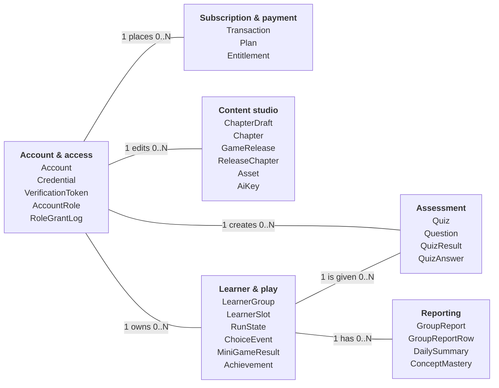
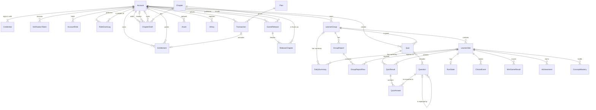
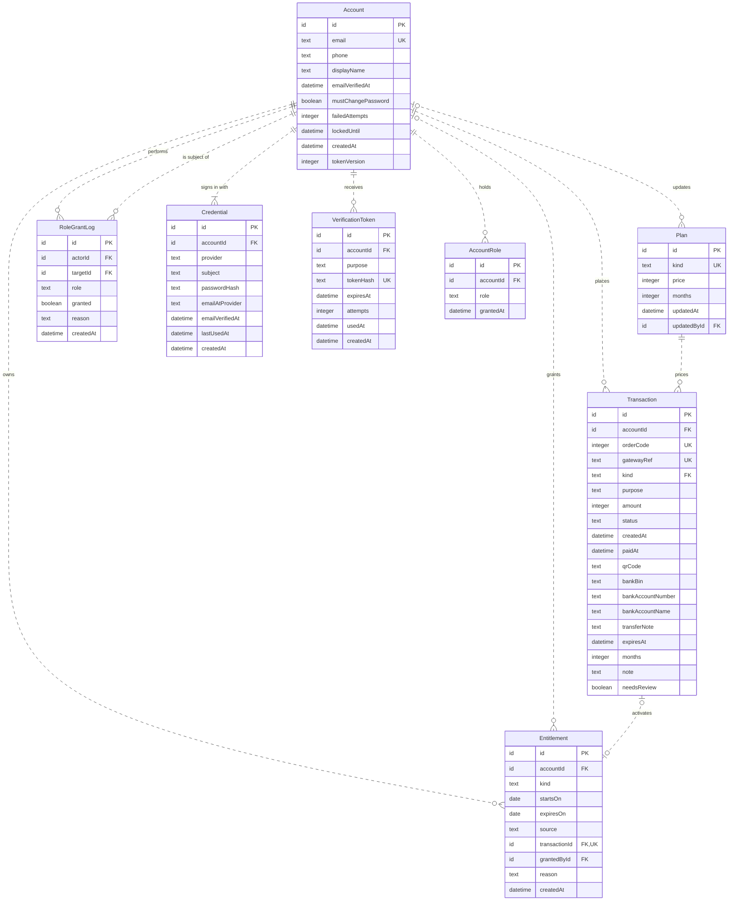
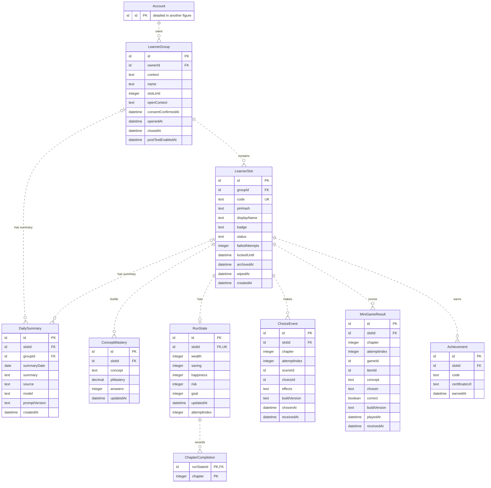
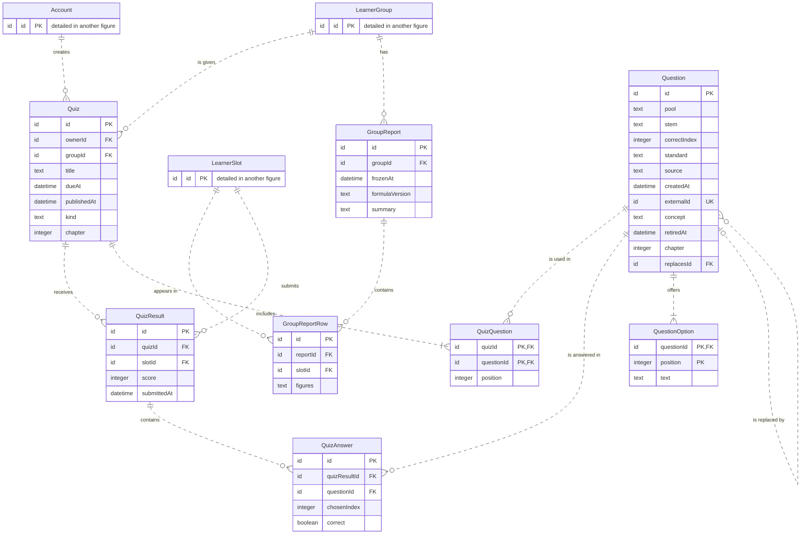
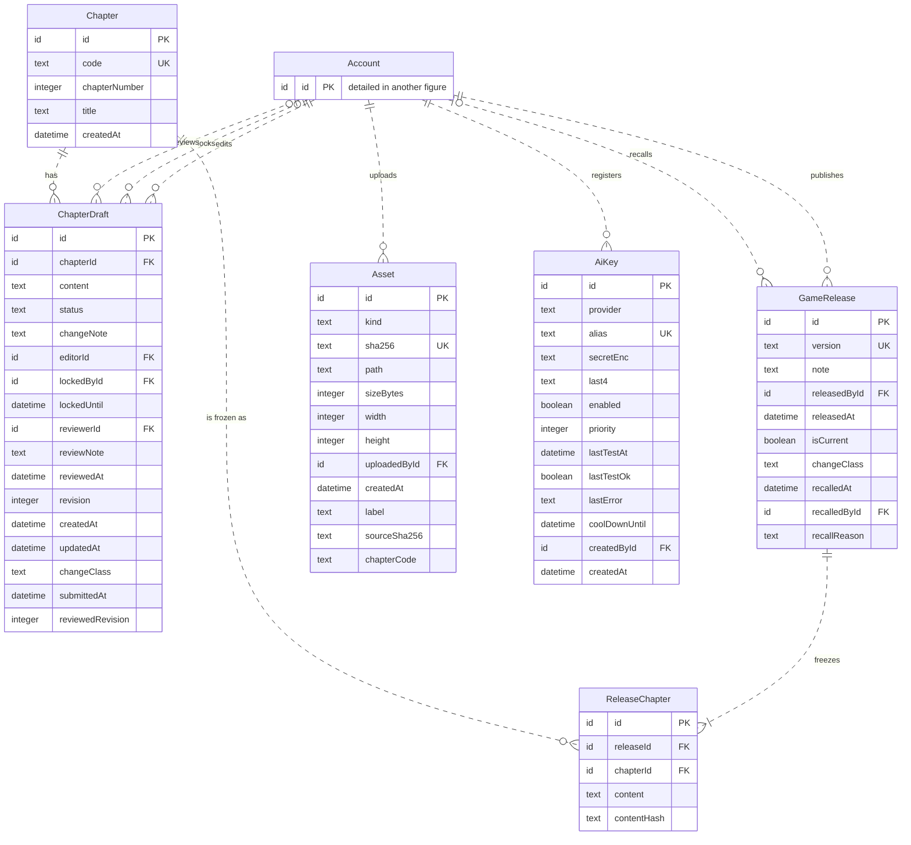
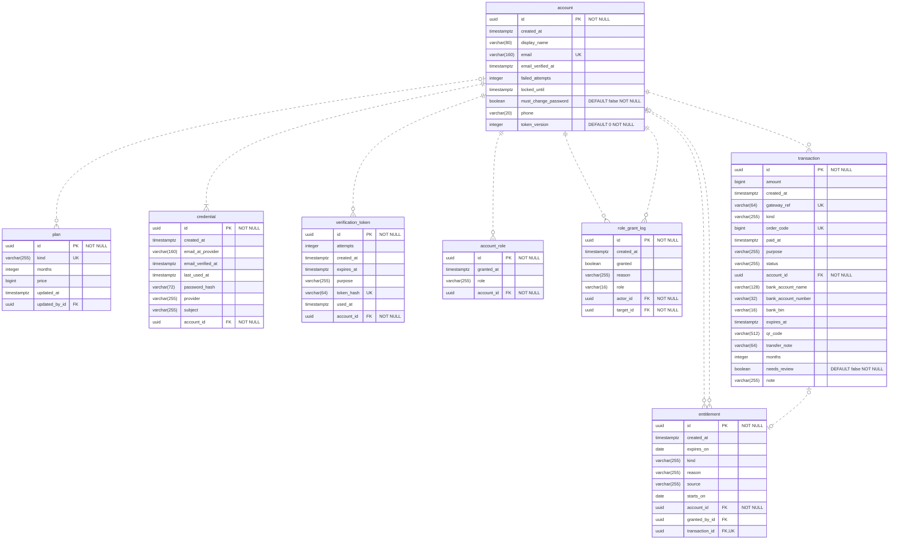
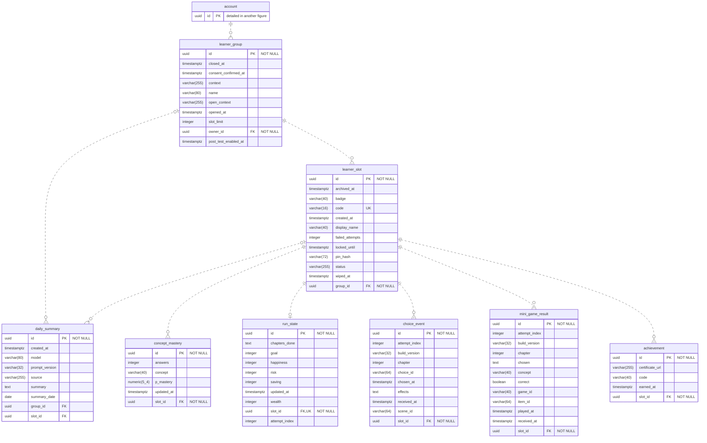
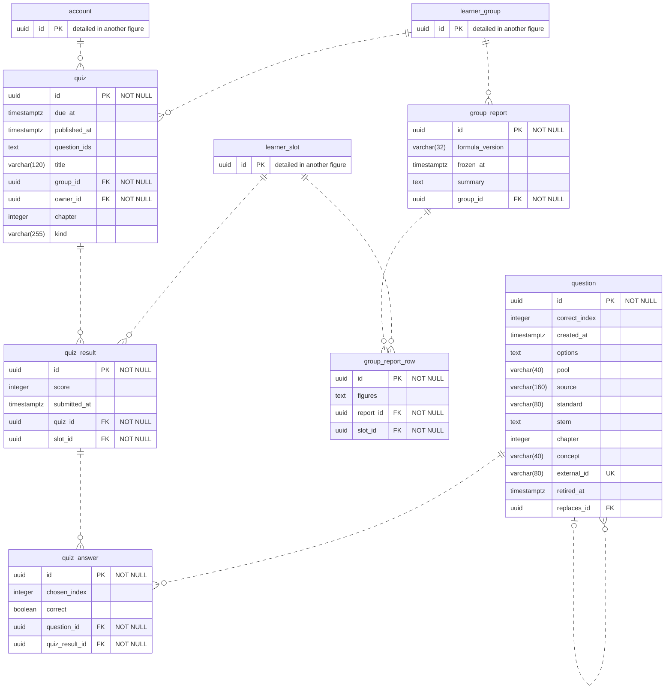
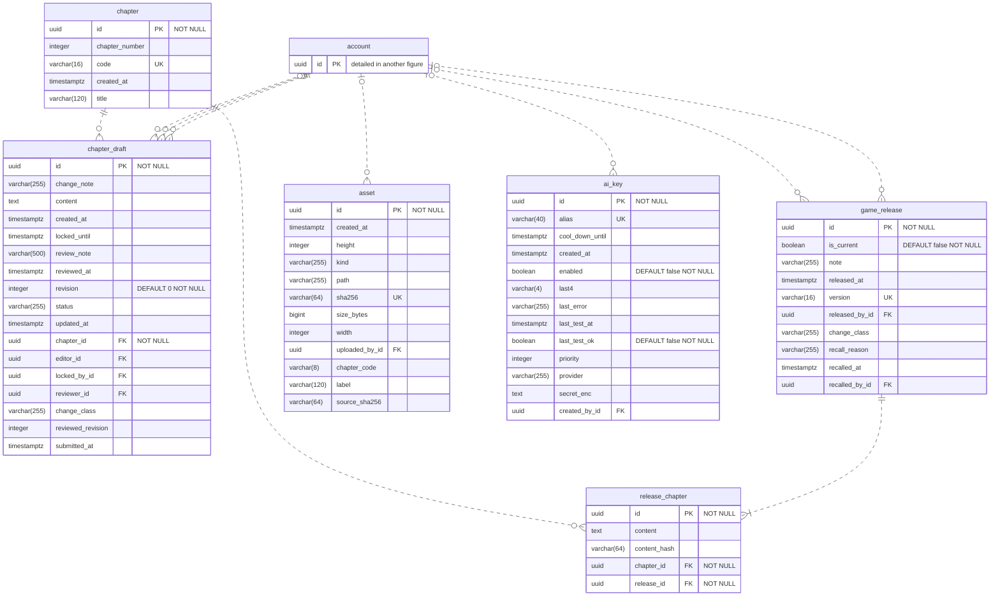

# FinTeen ERD (conceptual, logical, physical)

Generated by `Diagram/ERD/mermaid.py` from the approved draw.io figures (same entities, attributes, keys and
multiplicities). Crow's foot: `||` exactly one, `|o` / `o|` zero or one, `}o` / `o{` zero or many, `}|` / `|{` one or many.
Logical and physical relationships use surrogate keys, so they are non-identifying (dashed line).
Physical level = PostgreSQL 16 production schema; the DDL is in [`schema.sql`](schema.sql).

## 1. Conceptual — clusters

Six clusters; each line is the relationship between the lead entities (bold).

## 2. Conceptual — all entities

28 entities, names and relationships only.

Business rules not expressible in the notation:

- Each Entitlement comes from exactly one of a Transaction or an Account grant
- Each DailySummary belongs to exactly one of LearnerGroup or LearnerSlot

## 3. Logical

### Logical 1 — Account, access, subscription and payment

Constraints:

- `Transaction`: FK kind references Plan.kind (UQ)
- `Entitlement`: CHECK (exactly one of transactionId, grantedById is not NULL)
- `Credential`: UNIQUE (provider, subject)
- `AccountRole`: UNIQUE (accountId, role)
- `AccountRole`: CHECK (role IN ('ADMIN', 'GAME_EDITOR', 'GAME_REVIEWER', 'GAME_MANAGER'))

### Logical 2 — Learner groups and play

Constraints:

- `LearnerGroup`: UNIQUE (ownerId, openContext)
- `DailySummary`: UNIQUE (groupId, summaryDate)
- `DailySummary`: UNIQUE (slotId, summaryDate)
- `DailySummary`: CHECK (exactly one of slotId, groupId is not NULL)
- `ConceptMastery`: UNIQUE (slotId, concept)
- `ChoiceEvent`: UNIQUE (slotId, chapter, attemptIndex, sceneId)
- `MiniGameResult`: UNIQUE (slotId, chapter, attemptIndex, gameId, itemId)
- `Achievement`: UNIQUE (slotId, code)

### Logical 3 — Assessment and reporting

Constraints:

- `Quiz`: UNIQUE (groupId, kind, chapter)
- `QuizResult`: UNIQUE (quizId, slotId)
- `QuizAnswer`: UNIQUE (quizResultId, questionId)
- `QuizQuestion`: UNIQUE (quizId, position)

### Logical 4 — Content studio and releases

Constraints:

- `ReleaseChapter`: UNIQUE (releaseId, chapterId)

## 4. Physical

### Physical 1 — Account, access, subscription and payment

Constraints:

- `plan`: CHECK (kind IN ('PARENT', 'TEACHER'))
- `credential`: UNIQUE (provider, subject)
- `credential`: CHECK (provider IN ('GOOGLE', 'PASSWORD'))
- `verification_token`: CHECK (purpose IN ('RESET_PASSWORD', 'VERIFY_EMAIL'))
- `account_role`: UNIQUE (account_id, role)
- `account_role`: CHECK (role IN ('ADMIN', 'CHILD', 'GAME_EDITOR', 'GAME_MANAGER', 'GAME_REVIEWER', 'GUEST', 'PARENT', 'TEACHER'))
- `entitlement`: CHECK (kind IN ('PARENT', 'TEACHER'))
- `entitlement`: CHECK (source IN ('ADMIN', 'PAYMENT'))
- `transaction`: CHECK (kind IN ('PARENT', 'TEACHER'))
- `transaction`: CHECK (purpose IN ('NEW', 'RENEW'))
- `transaction`: CHECK (status IN ('FAILED', 'PAID', 'PENDING'))

### Physical 2 — Learner groups and play

Constraints:

- `learner_group`: UNIQUE (owner_id, open_context)
- `learner_group`: CHECK (context IN ('CLASS', 'FAMILY'))
- `learner_group`: CHECK (open_context IN ('CLASS', 'FAMILY'))
- `learner_slot`: CHECK (status IN ('ACTIVE', 'ARCHIVED', 'WIPED'))
- `daily_summary`: UNIQUE (group_id, summary_date)
- `daily_summary`: UNIQUE (slot_id, summary_date)
- `daily_summary`: CHECK (source IN ('LLM', 'RULE'))
- `concept_mastery`: UNIQUE (slot_id, concept)
- `choice_event`: UNIQUE (slot_id, chapter, attempt_index, scene_id)
- `mini_game_result`: UNIQUE (slot_id, chapter, attempt_index, game_id, item_id)
- `achievement`: UNIQUE (slot_id, code)

### Physical 3 — Assessment and reporting

Constraints:

- `quiz`: UNIQUE (group_id, kind, chapter)
- `quiz`: CHECK (kind IN ('CLASS_TEST', 'POST_TEST'))
- `quiz_result`: UNIQUE (quiz_id, slot_id)
- `quiz_answer`: UNIQUE (quiz_result_id, question_id)

### Physical 4 — Content studio and releases

Constraints:

- `chapter_draft`: CHECK (change_class IN ('MAJOR', 'MINOR', 'PATCH'))
- `chapter_draft`: CHECK (status IN ('APPROVED', 'DRAFT', 'REJECTED', 'RELEASED', 'SUBMITTED'))
- `game_release`: CHECK (change_class IN ('MAJOR', 'MINOR', 'PATCH'))
- `asset`: CHECK (kind IN ('AUDIO', 'IMAGE'))
- `ai_key`: CHECK (provider IN ('GEMINI', 'OPENROUTER'))
- `release_chapter`: UNIQUE (release_id, chapter_id)
