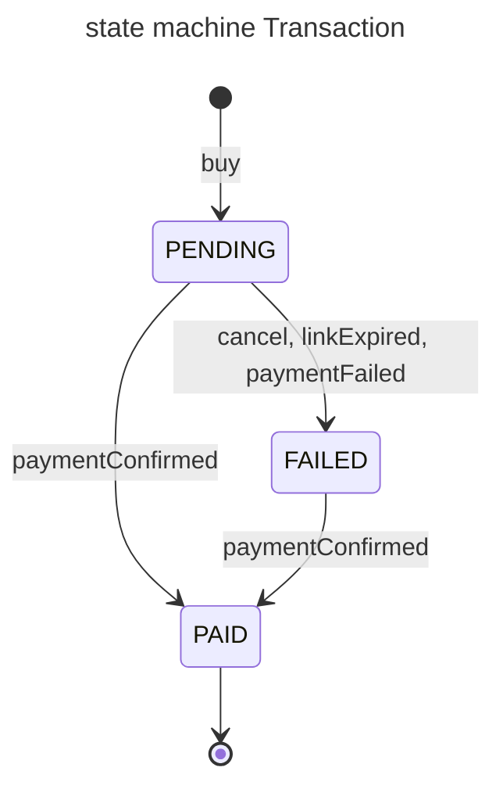
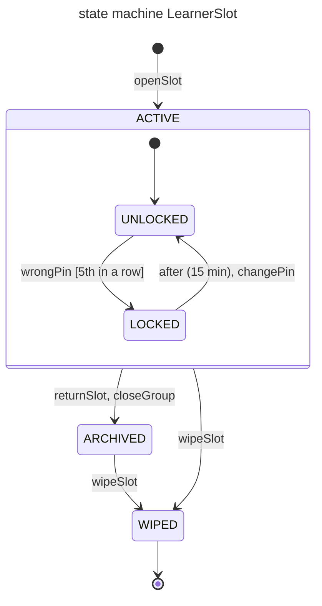
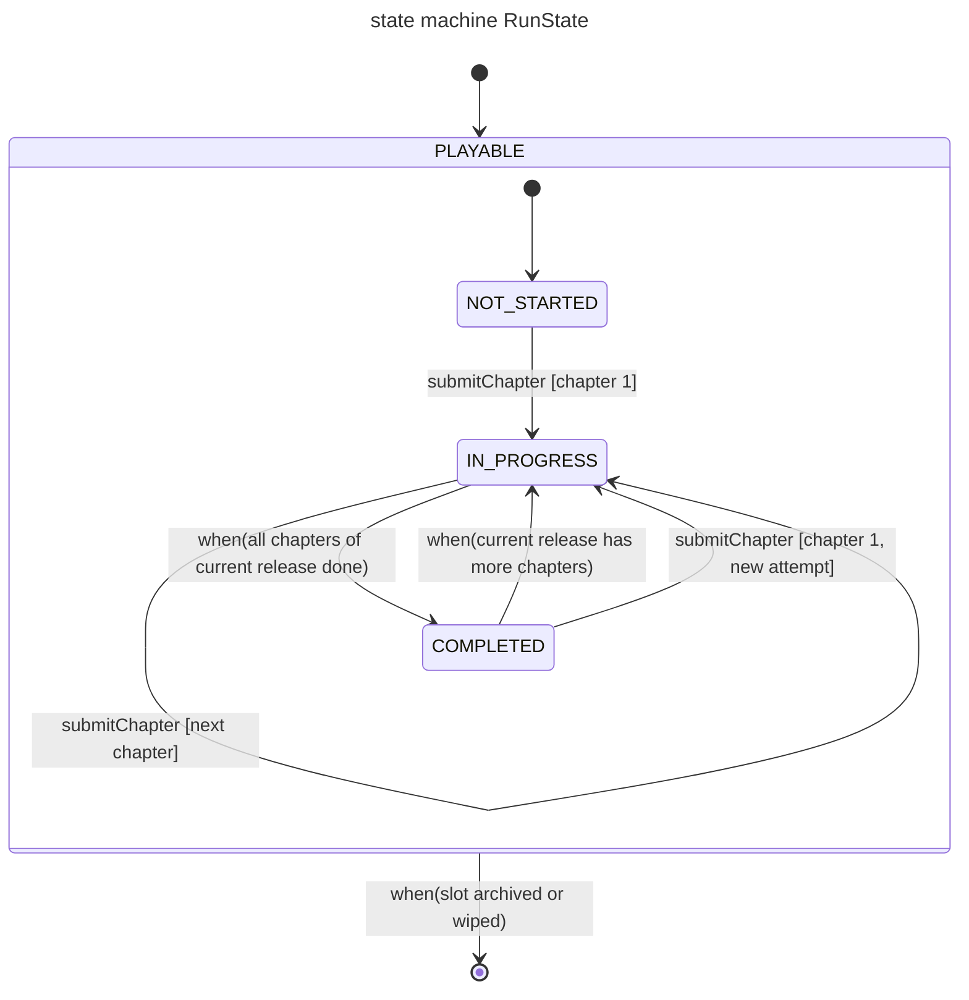
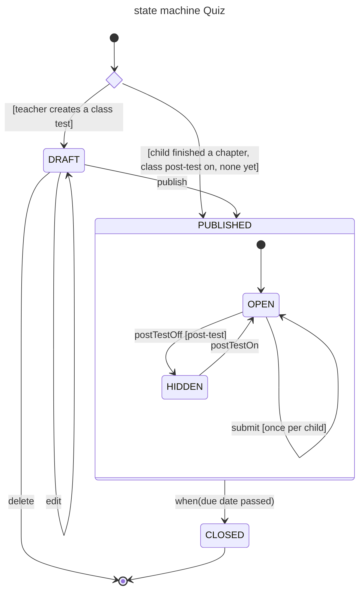
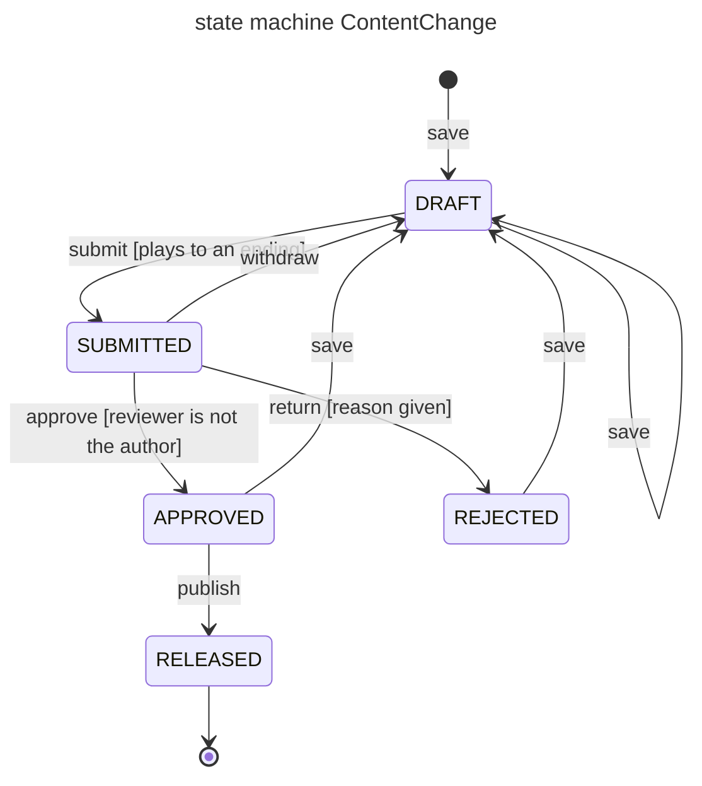
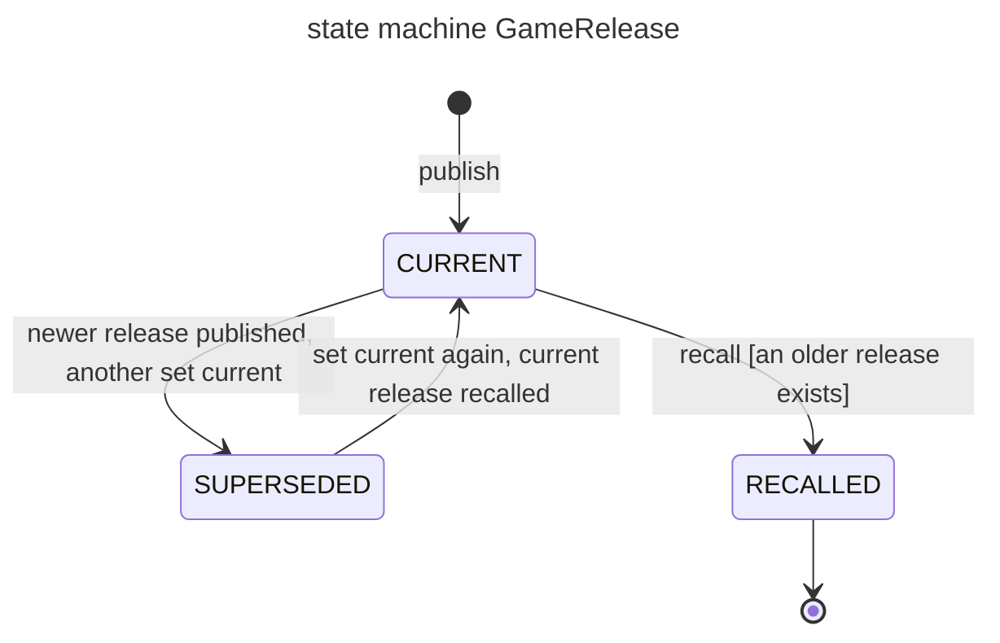

# FinTeen state machines (simplified, Review 2)

Mermaid transcription of the approved draw.io figures in `Diagram/STATE-MACHINE/sm-*-simple.drawio` (English versions;
the PNGs are used in the report). Same states, transitions, labels, initial and final pseudostates.
Label syntax: `event [guard]`; `when(...)` is a change event; `after (...)` is a time event.
Line breaks inside draw.io labels are written as a single space.

## Transaction lifecycle

A payment transaction starts PENDING and ends PAID; a FAILED transaction can still become PAID if payment is confirmed late.

## LearnerSlot lifecycle

A learner slot is ACTIVE (UNLOCKED or temporarily LOCKED by wrong PINs) until it is archived or wiped; WIPED is terminal.

## RunState lifecycle

A child's run stays PLAYABLE, moving from NOT_STARTED through IN_PROGRESS to COMPLETED, and ends when the slot is archived or wiped.

The draw.io figure draws the initial arrow straight to NOT_STARTED inside PLAYABLE; here it is written as the
equivalent default entry (`[*] --> PLAYABLE`, then `[*] --> NOT_STARTED` inside), because Mermaid's default layout drops
the `PLAYABLE --> [*]` arrow otherwise. Same UML semantics.

## Quiz lifecycle

A quiz is either a teacher-made DRAFT that gets published or an auto-created post-test that starts PUBLISHED, and it closes when the due date passes.

`entry_choice` is the unnamed choice pseudostate (diamond) of the draw.io figure; Mermaid needs an identifier for it.
The draw.io figure has two final pseudostates (after `delete` and after CLOSED); Mermaid draws every top-level `[*]`
target as one node, which is equivalent in UML (final states in the same region mean the same thing).

## Content release lifecycle

The draw.io figure holds two state machines: ContentChange (a chapter draft moving through review to release) and GameRelease (a published release being current, superseded or recalled).

### ContentChange

### GameRelease

